<picture>
  <source media="(prefers-reduced-motion: reduce)" srcset="assets/krishna-hero-static.svg">
  
</picture>

## About

I'm a final-year computer science student at VIT Chennai (CGPA 9.63, top 1% of the department), working toward ML engineering roles. Most of my work sits in medical imaging and applied deep learning, with a second research thread in lightweight security for IoT and robot-swarm networks.

Right now I'm finishing **LARW/CLASP**, a latency-adaptive authentication scheme for IoT and robot swarms, written up for *Computers & Security* (Elsevier). 

Outside the lab I chaired the ACM Student Chapter at VIT Chennai, and I've interned as a Network Engineer at Power Grid Corporation of India.

## Recognition

- **Best Paper**, ICRTAC 2024, for lung cancer CT classification
- Published in *Computers in Biology and Medicine* (IF 6.3), *IEEE Access* (IF 3.4) and *IEEE Internet of Things Journal* (IF 8.9)
- **Chairperson**, ACM Student Chapter, VIT Chennai
- Patent application no. 202541043541, fog and dew-point prediction for aviation and flood early warning

## Research

| Work | Venue | Notes |
|---|---|---|
| **CHASHNIt**, a CNN-Transformer skin lesion classifier | *Computers in Biology and Medicine* | Repository to be published |
| **Lung cancer CT classification** | ICRTAC 2024 | Best Paper |
| **Improved Layered NEHA**, hierarchical lightweight IoT encryption | *IEEE Internet of Things Journal* | |
| **SpectroNet-LSTM**, cardiac anomaly detection from spectrograms | ICCCSP '25 | [Code](https://github.com/itsinkbound/spectronet-lstm) |
| **LARW / CLASP**, latency-adaptive replay-window authentication | *Computers & Security*, in progress | Scyther formal verification and Monte Carlo simulation |
| **SHERA**, SHAP-enhanced resource allocation for VM scheduling | *IEEE Access* | With A. S. Slathia et al. |
| DDoS threat prediction with interpretable ML (RF, SMOTE, SHAP, LIME) | *Real-World Applications of Machine Learning*, Springer | Book chapter |
| Quantifying SIMD acceleration in JSON parsing | Solo-authored benchmark | [Code](https://github.com/itsinkbound/Benchmarking-experiment-cpp_parser-vs-simdjson_parser) |

Other patents: the Lumi Dissect light-pipe surgical device, a wearable multi-modal energy-harvesting device (piezoelectric, solar, thermoelectric), and a Raspberry Pi smart agricultural monitoring dome. Full list with DOIs on [ORCID](https://orcid.org/0009-0000-1944-0514).

## Selected projects

<table>
<tr>
<td width="50%" valign="top">

**[SpectroNet-LSTM](https://github.com/itsinkbound/spectronet-lstm)** 
Cardiac anomaly detection through spectrogram analysis.

</td>
<td width="50%" valign="top">

**CHASHNIt** 
A CNN-Transformer hybrid for skin lesion classification. Repository coming.

</td>
</tr>
<tr>
<td width="50%" valign="top">

**Lung cancer CT classifier** 
ResNet50 and EfficientNetB3 backbones, staged toward EC2 deployment.

</td>
<td width="50%" valign="top">

**[SIMD JSON benchmark](https://github.com/itsinkbound/Benchmarking-experiment-cpp_parser-vs-simdjson_parser)** 
A standard C++ parser measured against simdjson.

</td>
</tr>
</table>

## Skills

| | |
|---|---|
| **Languages** | Python, C++, Java, Go, SQL (MySQL) |
| **Machine learning** | PyTorch, TensorFlow, CNN-Transformer hybrids, SHAP, LIME, SMOTE, Random Forest |
| **Security research** | Scyther formal verification, Monte Carlo simulation |
| **Infrastructure** | AWS (EC2), Docker, Linux, Git |
| **Writing** | LaTeX |

## Contributions

Live public contributions, drawn from GitHub.

## Statistics

## Elsewhere

[LinkedIn](https://www.linkedin.com/in/krishna-priyadarshan-behara-54b487289) · [ORCID](https://orcid.org/0009-0000-1944-0514) · [GitHub](https://github.com/itsinkbound)

